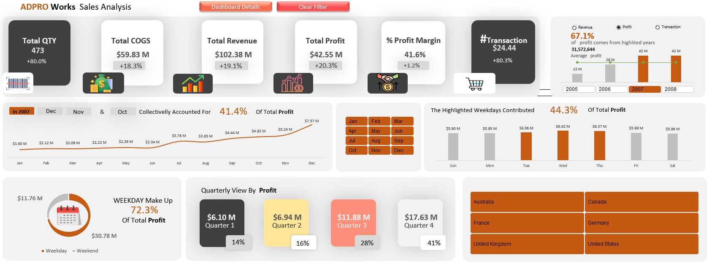
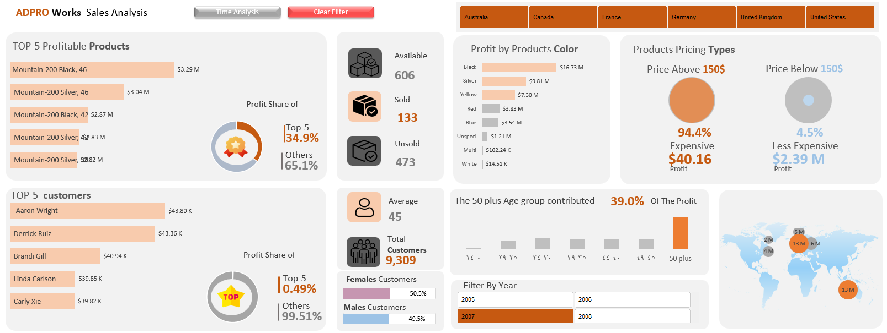

Sales Analysis
Interactive Excel Dashboard | تحليل المبيعات باستخدام Excel

---

## English

1. Project Overview
An interactive sales analysis dashboard developed using Microsoft Excel and AdventureWorks data.

The project analyzes sales performance, profitability, products, and customer data from 2005 to 2008 across six countries.

2. Business Questions
This project aims to answer the following questions:

- How did sales and profit change over time?
- Which countries contributed most to revenue?
- Which products performed best?
- What are the main characteristics of the customers?
- What patterns and trends can be identified in sales data?

3. Dashboard Features
The dashboard includes several analysis sections:

-Time Series Analysis: Explore sales performance over time.
-Sales Analysis: Review revenue, costs, and profitability.
-Product Analysis: Examine product performance.
-Customer Analysis: Explore customer-related information.

Interactive filters allow users to explore the data by year, month, and country.

4. Tools & Technologies
- Microsoft Excel
- Power Query
- Power Pivot
- PivotTables
- Interactive Charts and Slicers
- VBA

5. Skills Demonstrated
- Data cleaning and transformation
- Data modeling
- Exploratory data analysis
- Business performance analysis
- Dashboard development
- Data visualization

6. Project Files
- Excel workbook (`.xlsm`)
- Dashboard screenshots
- Project documentation

7. Project Purpose
This project demonstrates the use of Excel for transforming raw data into interactive dashboards and meaningful business insights.

## Dashboard Preview

 Dashboard 1

 Dashboard 2

## Key Business Insights

### 1. Revenue Comparison (2007–2008)
- 2007: $102.38M
- 2008: $101.86M

Revenue decreased slightly in 2008 compared to 2007.

### 2. Profit Comparison
- 2007: $42.55M
- 2008: $42.16M

Total profit remained relatively stable, with a slight decrease in 2008.

### 3. Profit Margin
- 2007: 41.6%
- 2008: 41.4%

The profit margin remained almost unchanged across both years.

### 4. Sales Quantity
- 2007: 473
- 2008: 504

Sales quantity increased in 2008, despite the slight decrease in revenue and profit.

### 5. Quarterly Profit Distribution (2007)
- **Strongest quarter:** Q4, contributing approximately 41% of annual profit.
- **Weakest quarter:** Q1, contributing approximately 14%.

### 6. Monthly Profit Analysis (2007)
- **Highest-performing month:** December, with approximately $7.97M in profit.
- **Lowest-performing month:** January, with approximately $1.80M in profit.

The results show significant variation in monthly profit, highlighting seasonal differences in business performance.

## Business Recommendations

1. **Strengthen Q1 Sales:** Introduce targeted promotions and marketing campaigns during the first quarter to improve performance during the weakest period.

2. **Prepare for Q4 Demand:** Increase inventory availability and ensure operational readiness ahead of the fourth quarter, which generated the highest profit in 2007.

3. **Optimize Monthly Sales Performance:** Analyze the reasons behind the low profits in January and explore opportunities to improve sales during this month.

4. **Investigate Sales Quantity vs. Revenue:** Although sales quantity increased in 2008, revenue and profit decreased slightly. Investigate product mix and average selling prices to understand this difference.

5. **Use Data-Driven Planning:** Monitor monthly and quarterly performance regularly to identify seasonal trends and support better business decisions.

---

## Data Limitations

The 2008 dataset covers January through July only. Therefore, the comparison between 2007 and 2008 is based on different reporting periods and should be interpreted with caution.

---

<h2>1. نظرة عامة على المشروع</h2>

مشروع لتحليل المبيعات باستخدام Microsoft Excel وبيانات شركة AdventureWorks، من خلال إنشاء لوحة معلومات تفاعلية تساعد على فهم أداء المبيعات والربحية والمنتجات والعملاء.

يغطي المشروع الفترة من 2005 إلى 2008، ويشمل بيانات ست دول.

يهدف المشروع إلى الإجابة عن مجموعة من الأسئلة:

- كيف تغيرت المبيعات والأرباح بمرور الوقت؟
- ما الدول الأكثر مساهمة في الإيرادات؟
- ما المنتجات الأفضل أداءً؟
- ما أبرز خصائص العملاء؟
- ما الأنماط والاتجاهات التي يمكن اكتشافها في بيانات المبيعات؟

<h2>2. معاينة لوحة المعلومات</h2>

<h2>3. مميزات لوحة المعلومات</h2>

تتضمن لوحة المعلومات عدة أقسام تحليلية:

- تحليل السلاسل الزمنية: متابعة أداء المبيعات عبر الزمن.
- تحليل المبيعات: مراجعة الإيرادات والتكاليف والربحية.
- تحليل المنتجات: دراسة أداء المنتجات.
- تحليل العملاء: استكشاف البيانات المتعلقة بالعملاء.

كما تتيح أدوات التصفية التفاعلية استكشاف البيانات حسب السنة والشهر والدولة.

<h2>4. الأدوات والتقنيات المستخدمة</h2>

- Microsoft Excel
- Power Query
- Power Pivot
- PivotTables
- المخططات وأدوات التصفية التفاعلية (Slicers)
- VBA

<h2>5. المهارات التي يعرضها المشروع</h2>

- تنظيف البيانات وتحويلها.
- نمذجة البيانات.
- التحليل الاستكشافي للبيانات.
- تحليل أداء الأعمال.
- تصميم لوحات المعلومات.
- عرض البيانات بصرياً.

<h2>6. ملفات المشروع</h2>

- ملف Excel بصيغة XLSM.
- صور لوحات المعلومات.
- توثيق المشروع.

<h2>7. هدف المشروع</h2>

يهدف المشروع إلى توضيح كيفية استخدام Excel لتحويل البيانات الأولية إلى لوحات معلومات تفاعلية واستخراج رؤى تساعد على فهم أداء الأعمال واتخاذ القرارات.

<h2>8. أهم النتائج والتحليلات</h2>

<h3>مقارنة الإيرادات (2007–2008)</h3>

- 2007: <bdi dir="ltr">$102.38M</bdi>
- 2008: <bdi dir="ltr">$101.86M</bdi>

انخفضت الإيرادات بشكل طفيف في عام 2008 مقارنة بعام 2007.

<h3>مقارنة الأرباح</h3>

- 2007: <bdi dir="ltr">$42.55M</bdi>
- 2008: <bdi dir="ltr">$42.16M</bdi>

ظل إجمالي الأرباح متقارباً مع انخفاض طفيف في عام 2008.

<h3>هامش الربح</h3>

- 2007: <bdi dir="ltr">41.6%</bdi>
- 2008: <bdi dir="ltr">41.4%</bdi>

ظل هامش الربح شبه مستقر بين العامين.

<h3>كمية المبيعات</h3>

- 2007: <bdi dir="ltr">473</bdi>
- 2008: <bdi dir="ltr">504</bdi>

ارتفعت كمية المبيعات في 2008 رغم الانخفاض الطفيف في الإيرادات والأرباح.

<h3>توزيع الأرباح حسب الأرباع (2007)</h3>

- أقوى ربع: الربع الرابع، وساهم بنحو 41% من الأرباح السنوية.
- أضعف ربع: الربع الأول، وساهم بنحو 14%.

<h3>تحليل الأرباح الشهرية (2007)</h3>

- أعلى شهر: ديسمبر، بأرباح تقارب <bdi dir="ltr">$7.97M</bdi>.
- أقل شهر: يناير، بأرباح تقارب <bdi dir="ltr">$1.80M</bdi>.

تُظهر النتائج تفاوتاً واضحاً في الأرباح الشهرية، مما يبرز الاختلافات الموسمية في أداء الشركة.

<h2>9. التوصيات التجارية</h2>

1. تعزيز المبيعات في الربع الأول: إطلاق عروض ترويجية وحملات تسويقية مستهدفة خلال الربع الأول لتحسين
